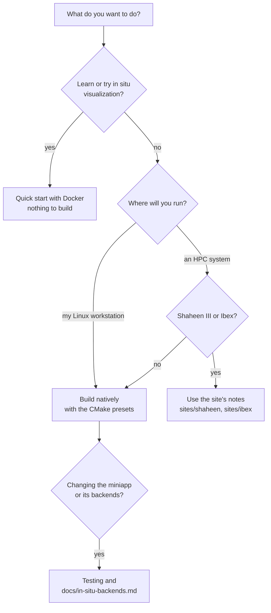

# Gray-Scott miniapp

A 3D reaction-diffusion simulation that feeds the in situ and in transit
visualization backends used across the Visualization Vignettes: VTK PVTI
files, Catalyst 2 (ParaView), Ascent, ADIOS2 (BP5 files and SST staging) and
Kombyne-lite. It is small enough to read in an afternoon and large enough to
run on thousands of cores, which makes it a fair test bed for comparing how
those backends get, move and render the same data.

It solves the [Gray-Scott model](https://doi.org/10.1126/science.261.5118.189)
for two chemicals, U (consumed) and V (produced):

```text
du/dt = Du * lap(u) - u * v^2 + F * (1 - u) + noise * r      r in [-1, 1), from (seed, step, x, y, z)
dv/dt = Dv * lap(v) + u * v^2 - (F + k) * v
```

with a 7-point Laplacian on a unit-spaced grid (the stencil sum is divided
by 6) and a forward Euler step of size `dt`.

Contents: [getting started](#getting-started-pick-your-path) ·
[quick start with Docker](#quick-start-with-docker) ·
[how it works](#how-it-works) ·
[prerequisites](#prerequisites) · [build](#build) · [run](#run) ·
[parameters](#parameters) · [outputs](#outputs) · [performance](#performance) ·
[testing](#testing) ·
[troubleshooting](#troubleshooting) · [more documentation](#more-documentation)

---

## Getting started: pick your path

New to the miniapp? Start with Docker: the image has everything built, so
you can run your first in situ visualization in a few minutes without
compiling anything.



| I want to... | Go to |
| :--- | :--- |
| try it, or follow a class or tutorial | [Quick start with Docker](#quick-start-with-docker) |
| build it on my own Linux machine | [Prerequisites](#prerequisites), then [Build](#build) |
| run on Shaheen III or Ibex | [`sites/shaheen/README.md`](sites/shaheen/README.md), [`sites/ibex/`](sites/ibex/) |
| change the miniapp or a backend | [Build](#build), [Testing](#testing), [`docs/in-situ-backends.md`](docs/in-situ-backends.md) |

---

## Quick start with Docker

You need [Docker Desktop](https://www.docker.com/products/docker-desktop/)
(Windows, macOS) or [Docker Engine](https://docs.docker.com/engine/install/)
(Linux). The image is about 4.5 GB to download.

1. **Download the image** (once):

   ```bash
   docker pull ghcr.io/jameskress/visualization_vignettes:latest
   ```

2. **Make a folder for your results and start the container.** The folder,
   `gray-scott-run` in your home folder, is shared with the container as
   `/app/data`: files the miniapp writes there appear on your computer. The
   container starts only if the folder was created, so an earlier run is
   never overwritten; if the folder exists, pick another name (PowerShell
   prints an error saying it exists). If `docker run` itself fails after the
   folder was made, fix the problem and run only the `docker run ...` part
   again.

   Linux or macOS:

   ```bash
   mkdir "$HOME/gray-scott-run" && docker run -it --rm -e HOST_UID=$(id -u) -e HOST_GID=$(id -g) -v "$HOME/gray-scott-run:/app/data" ghcr.io/jameskress/visualization_vignettes:latest
   ```

   Windows (PowerShell):

   ```powershell
   if (New-Item -ItemType Directory "$HOME\gray-scott-run" -ErrorAction Continue) { docker run -it --rm -v "$HOME\gray-scott-run:/app/data" ghcr.io/jameskress/visualization_vignettes:latest }
   ```

   You now have a prompt inside the container, in `/app/data`
   (`vizuser@...:/app/data$`).

   If the container cannot write to the folder: on Linux with SELinux
   (Fedora, RHEL), add `:z` to the mount, `-v "$HOME/gray-scott-run:/app/data:z"`;
   this relabels the folder, so use one only for results. These commands
   assume the standard Docker setup (Docker Desktop, or Docker Engine run by
   a user in the `docker` group); rootless Docker maps users differently and
   is not covered here.

3. **Copy the miniapp and its example settings** into your folder. Run it
   once per folder: it overwrites files of the same name.

   ```bash
   setup_rundir.sh
   ```

4. **Run a simulation** with ParaView Catalyst rendering images as it goes:

   ```bash
   mpirun -np 2 ./gray-scott --settings-file=./settings-catalyst-insitu.json
   ```

   It runs 100 steps and renders an image every 10, so expect about a
   minute. The images, `RenderView1_000000.jpg` to `RenderView1_000090.jpg`,
   appear in the `datasets/` folder inside your results folder on your
   computer (`~/gray-scott-run/datasets/` if you kept that name). Try the other
   `settings-*.json` files next; each uses a different backend (see
   [Outputs](#outputs)): `settings-vtk-pvti.json`, `settings-ascent.json`,
   `settings-catalyst-file-io.json`, `settings-adios-*.json` and
   `settings-none.json` all run in the image. Kombyne is not in the image
   (it needs its own licence), so `settings-kombyne.json` does not.

5. **Leave the container** with `exit`. Your results stay in
   `gray-scott-run/`.

The [build and run guide](docs/build-and-run-guide.md#running-with-docker)
has more: Windows Command Prompt, building the image yourself, and each
backend's settings.

---

## How it works

The global grid is `L x L x L` points, periodic in all three directions.
MPI splits it into a 3D grid of blocks (`MPI_Dims_create`,
`MPI_Cart_create`); each rank owns one block and stores it with one extra
layer of halo points on every face, filled from its neighbours each step.

```text
  Global domain L^3, periodic, split over P = px * py * pz ranks (here 2 x 2 x 1)

        +-----------+-----------+          One rank's block, one face shown
       /  rank 2   /  rank 3   /|
      +-----------+-----------+ |          h h h h h h h h      h = halo point,
     /  rank 0   /  rank 1   /| +          h o o o o o o h          copy of the
    +-----------+-----------+ |/           h o o o o o o h          neighbour's
    |           |           | +            h o o o o o o h          edge
    |  local    |  local    |/             h o o o o o o h      o = owned point
    |  block    |  block    +              h h h h h h h h
    +-----------+-----------+
      wraps around in x, y and z           size_x + 2 points per row

  Each step, on every rank:

    exchange halos      MPI_Sendrecv with each neighbour, faces xy then xz then yz
          |             (MPI derived datatypes, no packing buffers)
          v
    update interior     7-point Laplacian + reaction terms, forward Euler
          |
          v
    every plotgap steps
          |
          v
    writer ------> none | pvti | catalyst_io | catalyst_insitu | ascent | adios | kombyne
                     |       |          |             |            |       |        |
                   (skip) VTK files  ParaView     ParaView      Ascent  ADIOS2  Kombyne-lite
                                     writes files pipeline     actions  BP5/SST
                                                  in situ
```

Every backend follows the same rules. It gets the solver's arrays without
a copy (ADIOS2 only in memory-selection mode). Ghost cells are tagged,
except in ADIOS2, which writes each point once with no ghosts; a block-wise
reader of its output must add the overlap itself, and the in transit
reader does not yet (#42). Results match across backends and across rank
counts, noise included (the noise depends only on the seed, the step and
the global position), within what the checks test: the ghost volume test
compares cell counts and volumes, and the render check allows 0.1% of
pixels to differ by more than 24/255, and any number by less (the Kombyne iso surface uses some of that). Known
exceptions, such as a slice placed exactly on a plane two ranks share,
are listed in [in situ backends](docs/in-situ-backends.md). The
[build and run guide](docs/build-and-run-guide.md) covers each backend in
detail.

---

## Prerequisites

Measured on the KVL workstation; other Linux machines need the same pieces.

| | Required | Workstation |
| :--- | :--- | :--- |
| C++17 compiler | yes | GCC 9.5 |
| MPI | yes | Open MPI 4.1.2 (`mpicxx`, `mpirun`) |
| CMake | 3.22 or newer | 3.22.1 system; 3.31 under `~/packages` for building ParaView 6.2 |
| VTK | yes (the VTK logger is used throughout) | from the ParaView 6.2 source build, `~/packages/paraview-src/build_6.2.0/install` |
| Catalyst 2 | for `catalyst_*` output | same ParaView build (must match the VTK above) |
| Ascent | for `ascent` output | optional |
| ADIOS2 | for `adios` output and the in transit reader | optional |
| Kombyne-lite | for `kombyne` output | optional, free version 1.5 |
| GPU | not yet | two RTX A5000; GPU support is planned (`ENABLE_GPU`, off) |

VTK and Catalyst must come from the same ParaView build that Catalyst loads
at run time, or two copies of VTK end up in one process.

---

## Build

The miniapp ships CMake presets. They keep every optional backend off and
put each build under `build/<preset>`. The one machine-local path, `VTK_DIR`,
goes in `CMakeUserPresets.json`, which git ignores.

```bash
cd Miniapps/gray-scott
cp -n CMakeUserPresets.json.example CMakeUserPresets.json   # -n keeps an existing file; edit VTK_DIR if your ParaView lives elsewhere
cmake --list-presets
cmake --preset my-host-cpu
cmake --build --preset my-host-cpu -j
```

The binary is `build/my-host-cpu/gray-scott`.

| Preset | What it is |
| :--- | :--- |
| `host-cpu` | Release, MPI and VTK only |
| `host-cpu-debug` | Debug |
| `host-cpu-timers` | Release with `ENABLE_TIMERS` (per-step timers) |
| `host-cpu-asan` | AddressSanitizer and UndefinedBehaviorSanitizer, for `tests/sanitizers/run_sanitized.sh` |
| `my-host-cpu` | your copy of `host-cpu` with local paths, from the example file |

To turn a backend on, add it to your user preset with its path, for example:

```json
"cacheVariables": {
  "VTK_DIR": "$env{HOME}/packages/paraview-src/build_6.2.0/install/lib/cmake/paraview-6.2/vtk",
  "ENABLE_CATALYST": "ON",
  "catalyst_DIR": "$env{HOME}/packages/paraview-src/build_6.2.0/install/lib/cmake/catalyst-2.0"
}
```

The other switches are `ENABLE_ASCENT` (`Ascent_DIR`), `ENABLE_ADIOS2`
(`ADIOS2_DIR`), `ENABLE_KOMBYNELITE` (`kombynelite_DIR`) and
`BUILD_ANALYSIS_READER` (the ADIOS2 in transit reader). Ascent and Kombyne
cannot be enabled together. Building each backend SDK is covered in the
[build and run guide](docs/build-and-run-guide.md#how-to-build-locally).

---

## Run

Every run takes one settings file:

```bash
mpirun -np 1 build/my-host-cpu/gray-scott --settings-file=configs/miniapp-settings/settings-none.json
mpirun -np 2 build/my-host-cpu/gray-scott --settings-file=configs/miniapp-settings/settings-none.json
```

`settings-none.json` is a 64^3 grid for 100 steps with no output, a few
seconds on one core: the quickest check that a build works. Other settings
files under `configs/miniapp-settings/` turn on each backend. Add
`--logging-level=TRACE` for more detail (levels: `OFF`, `ERROR`,
`WARNING`, `INFO`, `TRACE`).

The step count, grid and output are all in the settings file; the
[parameters](#parameters) table explains each one.

---

## Parameters

From `simulation/settings.cpp`. Every key is required except those marked
optional; a settings file that leaves out a required key stops the run with
an error. The last column is the value in the code's constructor, for
reference only, except for the optional keys, where it is the value used
when the key is missing. The shipped files set every key
(`settings-none.json` uses L 64, 100 steps, Du 0.2, Dv 0.1, F 0.01, k 0.05,
dt 2.0, noise 1e-7).

All quantities are dimensionless. The solver works on a grid of spacing 1.
The backends publish the grid with spacing 0.1, so in ParaView,
VisIt or any output file the domain is 0.1 * L wide: divide output
distances by 0.1, and multiply output gradients by 0.1, to get solver units.

| Key | Meaning | Constructor value |
| :--- | :--- | :--- |
| `L` | grid points per side; the global grid is L^3 | 128 |
| `steps` | number of time steps | 20000 |
| `plotgap` | write output every this many steps | 200 |
| `F` | feed rate: U flows in, `F * (1 - u)` | 0.04 |
| `k` | kill rate: V is removed at `(F + k) * v` | 0.06075 |
| `Du` | diffusion coefficient of U | 0.05 |
| `Dv` | diffusion coefficient of V | 0.1 |
| `dt` | forward Euler time step | 0.2 |
| `noise` | amplitude of uniform noise in [-1, 1) added to U each step | 0.0 |
| `seed` | optional: seed for the noise; the value at each point and step depends only on the seed, the step and the global position, so reruns and any rank count give identical fields | 20261107 |
| `output_type` | `none`, `pvti`, `catalyst_io`, `catalyst_insitu`, `ascent`, `adios`, `kombyne` | `file` (set it explicitly) |
| `output_file_name` | output file or prefix for file-writing backends | `foo.bp` |
| `catalyst_script_path` | Catalyst Python script for `catalyst_*` | empty |
| `catalyst_lib_path` | Catalyst implementation library directory | empty |
| `adios_config` | ADIOS2 XML configuration | `adios2.xml` |
| `adios_span`, `adios_memory_selection` | ADIOS2 write paths (span or memory selection) | false |
| `mesh_type` | mesh description for backends that use it | `image` |
| `kombynelite_script_path` | Kombyne-lite script | empty |
| `checkpoint`, `checkpoint_freq`, `checkpoint_output` | ADIOS2 checkpoint after every N completed steps (a restart resumes from exactly that state); needs an `ENABLE_ADIOS2=ON` build (see below) | false, 2000, `ckpt.bp` |
| `restart`, `restart_input` | restart from a checkpoint; same requirement | false, `ckpt.bp` |
| `burn_in_steps` | optional: steps to run before output starts | 0 |
| `overwrite_last_step` | optional: keep only the latest output step. Every backend honours it except `catalyst_insitu`, whose script names its own files and keeps every step unless the script overwrites them | false |
| `perf_dir` | optional: parent directory of each run's performance log directory ([performance](#performance)) | `perf` |
| `sst_open_timeout_s` | analysis reader only (its settings file): whole seconds (rounded up, at least 1) the in transit reader waits for the simulation's SST stream to appear. The simulation may spend minutes reading a checkpoint first; ADIOS2's own default is 60 s | 600 |
| `teardown_timeout_s` | optional: seconds allowed for closing the output and `MPI_Finalize` once every output and the performance log are written; after that the process logs why and exits with status 0. 0 disables it. The analysis reader reads the same key from its settings file ([in situ backends](docs/in-situ-backends.md), Shutdown) | 300 |

Checkpointing and restart use ADIOS2 and are compiled only when
`ENABLE_ADIOS2=ON` (the presets turn it off). In any other build the
`checkpoint` and `restart` keys are read and ignored: no checkpoint is
written and a restart starts from step 0. Turn on ADIOS2 in
`CMakeUserPresets.json` and point `adios_config` at an ADIOS2 XML file (the
ones under `configs/adios2_configs/` work).

Stability: forward Euler on this stencil needs roughly `dt * max(Du, Dv) <= 1`
for the diffusion part; patterns form for F and k in the classic Pearson
ranges (the shipped values sit inside them).

---

## Outputs

| `output_type` | Needs | Writes |
| :--- | :--- | :--- |
| `none` | nothing | nothing; timing and correctness checks only |
| `pvti` | VTK | parallel VTK image files, one per output step |
| `catalyst_io` | Catalyst 2 | files written by a ParaView pipeline |
| `catalyst_insitu` | Catalyst 2 | whatever the Catalyst script renders or extracts |
| `ascent` | Ascent | whatever the Ascent actions file asks for |
| `adios` | ADIOS2 | BP5 files, or SST staging to the in transit reader |
| `kombyne` | Kombyne-lite | whatever the Kombyne script asks for |

How to run each one, with example settings, scripts and expected results, is
in the [build and run guide](docs/build-and-run-guide.md). That guide also
covers Docker, checkpoint and restart, and the in transit reader.

---

## Performance

Every run writes a performance record to its own directory,
`<perf_dir>/<UTC date-time>_<output_type>_np<ranks>/`. The format is
versioned (`schema_version`, now 2) because the analysis script and papers
depend on it. Change it only by bumping the version and updating this
section.

The record is written once the last step is done and before the output is
closed, so a shutdown that hangs (ADIOS2 SST over RDMA can) cannot lose it
(#75).

| File | Written | Contents |
| :--- | :--- | :--- |
| `metadata.json` | always, rank 0 | what ran, where and how it was built (below) |
| `summary.json` | always, rank 0 | loop wall time and ms/step; with timers on, per-timer totals across ranks |
| `steps/rank_NNNNN.jsonl` | timers on, every rank | one JSON object per step |

`metadata.json` records:

* **Build:** git commit, `git describe` and dirty state (tracked files only), compiler and version, flags, build type, enabled backends.
* **Host:** hostnames and node count, CPU model, CPU count, NVIDIA GPU models.
* **MPI:** library version, rank count, 3D decomposition, rank 0's local block size.
* **Problem:** `L`, steps, plotgap, F, k, Du, Dv, dt, noise and seed.
* **Inputs:** the settings file path and its full contents, the command line.
* **Backend:** output type, backend version and its script or configuration file.

The timers are compiled in only with `ENABLE_TIMERS`, in the
`host-cpu-timers` preset or with `-DENABLE_TIMERS=ON` in your user preset.
Without them, the performance log holds only the metadata and the wall
time, and the console shows one progress line per step.
With them, each step record holds these timers, in seconds per rank:

| Timer | Measures |
| :--- | :--- |
| `halo` | halo exchange (`MPI_Sendrecv` of all faces); includes waiting for neighbours. On output steps it also includes the refresh of the halo before the write |
| `stencil` | the 7-point update and the copy back |
| `compute_step` | `halo` + `stencil` as seen from `main`, except on output steps, where `halo` also holds the pre-write refresh and `compute_step` does not |
| `wrap` | building the backend's description of the data |
| `execute` | the backend's own work (pipeline, actions, engine) |
| `io` | files written or data sent |
| `write_step` | the whole backend call on output steps |
| `total_step` | one step, from barrier to barrier |
| `create_writer`, `writer_open`, `printSelf` | setup, in the first record only |
| `create_checkpoint` | ADIOS2 checkpoint writes |

Each record also holds the memory high-water mark (`rss_MB`), the
cumulative CPU time (`user_s`, `sys_s`) and these counters:

* `halo_bytes`: bytes this rank sent in the exchange, from the MPI datatype sizes.
* `backend_bytes`: bytes of field data handed to the backend on output steps: u and v with their halo layer for the mesh-based backends, the interior block for ADIOS2, 0 for `none`.
* `allocs_step`, `alloc_bytes_step`, `allocs_wrap`, `alloc_bytes_wrap`, `allocs_write`: heap allocations in the solver step, in our wrapping code and in the whole backend call (#25). These are counted only in builds configured with `-DGS_COUNT_ALLOCATIONS=ON` (which needs `ENABLE_TIMERS=ON`), a test-only replacement of the global allocation functions (Linux with glibc only) that must not be used for timing runs. Otherwise they are 0. The step and wrap counts cover the calling thread; the write count covers all threads.

How each backend reports `wrap`, `execute` and `io`:

* PVTI reports `wrap` (building the image) and `io` (the rest of `Write()`).
* Backends that do not split their work yet count the whole call as `execute`. Catalyst, Ascent, ADIOS2 and Kombyne get their split in the phase 3 backend issues.

With timers on, rank 0 prints the maximum over ranks each step:

```text
[Step 12] Stencil 2.439 ms | Halo 0.238 ms | Wrap 0.000 ms | Execute 0.000 ms
```

At the end it prints a summary: each timer's min, mean and max of the
per-rank totals, the imbalance across ranks (max/mean - 1) and its share of
the step. `summary.json` holds the same numbers.

Overhead: timers on against off on 64^3 for 1000 steps, median of 7 runs
on the workstation, cost +0.09% on 1 rank and +0.07% on 4 ranks. Step
records are kept in memory and written at the end, so the step loop does no
file I/O.

To turn a set of runs into tables and plots:

```bash
python3 scripts/perf_report.py perf/ --out perf_report
```

This writes `summary.md` and `summary.csv` (one row per run). When the
runs allow, it also writes `phases.png` (per-phase stacked bars; needs at
least one run built with timers) and `scaling.png` (ms/step against ranks
with ideal scaling; needs comparable runs, same backend, L, plotgap and
steps, at two or more rank counts). Each is captioned with the host, CPU,
compiler, MPI and commit of the runs. The plots need matplotlib.

---

## Testing

The build includes a numerical regression test of the simulation core
(`tests/test_numerical_regression.cpp`, on by default, `GS_BUILD_TESTS=OFF`
to skip it). It runs a fixed problem, 64^3 for 500 steps with noise on and
seed 20261107, on 1, 2 and 4 ranks:

```bash
ctest --test-dir build/my-host-cpu --output-on-failure
```

About ten seconds on the workstation. CI runs the same build and tests on
every pull request and every push to master (the "Gray-Scott Miniapp Tests" job,
`.github/scripts/ci_gray_scott.sh`, Debian 12 with its VTK 9.1 package).
Four tests run:

| Test | Checks |
| :--- | :--- |
| `gs_regression_np1`, `_np2`, `_np4` | budget every step, and the final norms against the golden file |
| `gs_regression_bitwise_1_2_4` | final U and V are bitwise identical on 1, 2 and 4 ranks |

What each check means:

* **Budget.** Gray-Scott does not conserve mass, but its budget is exact.
  Diffusion sums to zero on the periodic domain and the `u*v^2` terms cancel
  between U and V, so each step the change in sum(U+V) must equal
  `dt * sum[F(1-U) - (F+k)V + noise*r]`. The tolerance is 16 ulps of
  sum(|U|+|V|), about 1e-9. The worst observed residual is 1e-4 of that.
  A missing halo exchange breaks it on the first step (residual about 3).
* **Norms.** L2 and L-infinity of U and V must match
  `tests/golden/regression_L64_s500.txt` within 1e-12 relative. The L2 norms
  are MPI sums, so 2 and 4 ranks differ from the golden by about 3e-14. This
  catches errors that keep the budget, such as a wrong stencil weight.
* **Bitwise.** Each run hashes the gathered fields (FNV-1a over the bytes).
  The three hashes must be equal. This catches decomposition errors that the
  norms are too coarse to see.

**Backend ghost volume test** (#24, label `backends`). This test runs only
in builds with backends enabled, so CI skips it. Every enabled backend runs
the same seeded 64^3 problem to step 100 on 1, 2, 4 and 8 ranks. Each one
counts, in its own pipeline or with the reader of its output, the cells
where every corner has u <= 0.3, and integrates their volume:

* Catalyst runs a threshold and integration in situ.
* PVTI and Kombyne output is read back with pvpython.
* ADIOS2 output is read with `bpls` and counted directly on the global
  array.
* Ascent runs a threshold in situ and saves it with a relay extract,
  counted with h5py. Its threshold keeps a cell if any corner is in range,
  so it is checked against the ADIOS2 count under that rule.

A cell counted twice at a rank boundary, or a gap between ranks, changes
the integer count.

* **Across rank counts:** the count must be identical and the volume must
  agree within 1e-12.
* **Across backends:** `gs_ghost_volume_compare` requires equal counts.
  Ascent is checked only against the ADIOS2 any-corner count, so that check
  needs the ADIOS2 test (and `bpls`) too.

On the workstation Catalyst, PVTI, Kombyne and ADIOS2 count 356 cells on
every rank count; Ascent counts 2460 (any corner), equal to the ADIOS2
count under the same rule.

```bash
ctest --test-dir build/my-host-cpu -R '^gs_ghost_volume_' --output-on-failure   # use your build directory
```

(The `backends` label also selects the render checks below.)

**Backend render check** (#24, labels `backends` and `render`). Catalyst,
Ascent, PVTI and Kombyne have one; ADIOS2 does not, so a passing render
suite says nothing about it. Each enabled backend of those four renders the same views on 1 and 4 ranks, headless, and the
images must match: at most 0.1% of pixels may differ by more than 24/255.
The images are kept under `<build dir>/tests/render/<backend>/`. Needs
numpy and Pillow. See docs/in-situ-backends.md, Rendering.

```bash
ctest --test-dir build/my-host-cpu -L render --output-on-failure   # use your build directory
```

Set `GS_PVPYTHON` to a pvpython (any ParaView 6.2) for the PVTI and Kombyne
readers. `bpls` is found next to the ADIOS2 install. The Ascent test needs
h5py for the Python that runs CTest. A backend whose requirement is missing
gets no test, while the others still run and pass; check the configure
output ("Ghost volume test backends: ...") or `ctest -N` for what is
registered.

If you change the numerics on purpose, regenerate the golden file and say
why in the PR:

```bash
mpirun -np 1 build/my-host-cpu/tests/test_numerical_regression \
  --golden=tests/golden/regression_L64_s500.txt --bless
```

The golden norms come from GCC 9.5 on x86-64. A compiler that fuses
multiply-adds differently can move them by more than 1e-12. If so,
regenerate the file for that platform; the bitwise test is unaffected
because all three runs use the same binary. On a machine with fewer than 4
cores, configure with `-DGS_TEST_MPIEXEC_PREFLAGS=--oversubscribe`.

---

## Troubleshooting

**MPI on one machine**

* `There are not enough slots available`: Open MPI counts physical cores per
  slot. Add `--oversubscribe` to run more ranks than it thinks you have.
* Runs that are slower with more ranks on one node: Open MPI binds each rank
  to a core by default; check with `--report-bindings`, and on shared
  machines try `--bind-to none`.
* Errors that mention MPICH, or a crash at `MPI_Init`: the miniapp, VTK and
  ParaView were built against different MPI libraries. Rebuild them all with
  the same `mpicxx` and run with the matching `mpirun`
  (`which mpicxx mpirun` should point at the same installation).
* `Passed unrecognized argument`: the settings file must be passed as
  `--settings-file=<path>`, not as a bare path.

**Headless rendering** (Catalyst, Ascent, Kombyne on machines without a display)

* ParaView 6 chooses how to open a render window from
  `VTK_DEFAULT_OPENGL_WINDOW`: `vtkEGLRenderWindow` for GPU rendering without
  X, `vtkOSOpenGLRenderWindow` for OSMesa software rendering,
  `vtkXOpenGLRenderWindow` with a display. If none is set and there is no
  display, rendering fails or silently falls back to a slow software path.
* On a remote machine without a GPU, OSMesa is the reliable choice; on a GPU
  node, EGL. The backend check vignette
  (`ParaView_Vignettes/ex08_pvBackendCheck`) reports which one a ParaView
  build actually uses.
* Catalyst finds ParaView through `CATALYST_IMPLEMENTATION_PATHS` (the
  directory holding `libcatalyst-paraview.so`) and
  `CATALYST_IMPLEMENTATION_NAME=paraview`.

**Memory and undefined behaviour checks**

* Build the `my-host-asan` preset from `CMakeUserPresets.json.example` (it inherits `host-cpu-asan` and adds your `VTK_DIR`) and run `tests/sanitizers/run_sanitized.sh build/my-host-asan <ranks>`; a clean run prints nothing from the sanitizers. Details and the suppression file are in `tests/sanitizers/README.md`.

**Build**

* `Could not find a package configuration file provided by "VTK"`: `VTK_DIR`
  in your user preset does not point at a directory containing
  `vtk-config.cmake`.
* Presets not listed: CMake older than 3.22, or you are not in
  `Miniapps/gray-scott`.

---

## More documentation

* [Build and run guide](docs/build-and-run-guide.md): Docker, building each
  backend SDK, running each output type, checkpoint and restart, the in
  transit reader.
* [In situ backends](docs/in-situ-backends.md): the shared mesh description,
  ghost conventions and each backend's adaptor.
* [AGENTS.md](https://github.com/jameskress/Visualization_Vignettes/blob/master/AGENTS.md) (in the repository root): the working rules and target invariants for
  this miniapp.
* `sites/kw61316`, `sites/ibex`, `sites/shaheen`: machine-specific notes.
* The plan of work: phase issues #11, #18, #28, #38 and #46 on GitHub.
