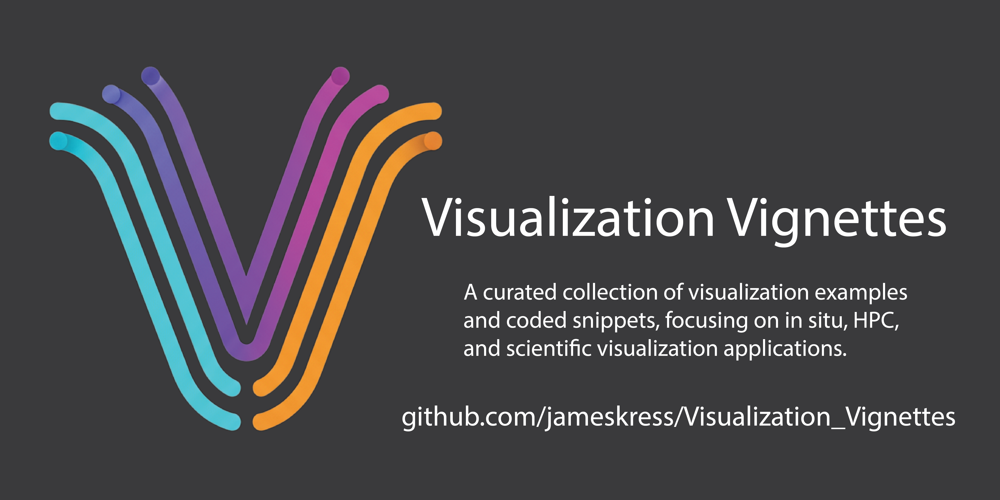

[](https://github.com/jameskress/Visualization_Vignettes/actions)
[](https://github.com/jameskress/Visualization_Vignettes/tags)

[](./Dockerfile)
[](https://github.com/jameskress/Visualization_Vignettes/pkgs/container/visualization_vignettes)


[](CONTRIBUTING.md)
[](CODE_OF_CONDUCT.md)

[](https://opensource.org/licenses/BSD-3-Clause)
[](./CITATION.cff)


# Visualization Vignettes
<p align="center">
  
</p>

Welcome to the **Visualization Vignettes** repository! This project is a "cookbook" of examples, best practices, and training materials for scientific and in situ visualization workflows, valuable for a global audience of researchers, students, and developers.

This repository is broadly divided into two sections:

1. A collection of stable **Visualization Tool Vignettes** for common tasks in ParaView and VisIt, often tailored for HPC environments.

2. An evolving section on **In Situ Processing**, centered on a "miniapp" that demonstrates co-processing with libraries like Ascent, Catalyst2, ADIOS2, and Kombyne. The detailed vignettes for this section are still under development.

## Table of Contents

* **General Documentation**

  * [Changelog](./.github/CHANGELOG.md)

  * [Contribution Guidelines](./.github/CONTRIBUTING.md)

  * [Code of Conduct](./.github/CODE_OF_CONDUCT.md)

* **Visualization Tool Vignettes**

  * [**ParaView Vignettes**](./ParaView_Vignettes/README.md)

    * Details ParaView use on HPC systems (both batch and interactively), as well as local workflows.

  * [**VisIt Vignettes**](./VisIt_Vignettes/README.md)

    * Details VisIt use on HPC systems (both batch and interactively), as well as local workflows.

* **Regression Testing**

  * [**Test Suite**](./Testing/README.md)

    * Running the suite, the five independent gates each vignette must pass, blessing baselines, and the committed performance history.

  * [**Runbook: every machine, both tools**](./Testing/RUNBOOK.md)

    * How to run the suite on a workstation, Ibex, Shaheen `workq` and Shaheen `ppn`, for ParaView and VisIt, online or air-gapped.

* **In Situ Processing Vignettes**

  * [**In Situ Overview**](./Miniapps/gray-scott/README.md)

* **Scripts**

  * Scripts that can help with visualization or movie making outside of ParaView or VisIt.

* **[data](./data/README.md)**

  * The datasets the ParaView and VisIt vignettes read: what ships with the repository, what is fetched, and what is generated per machine.

## Getting Started

There are two primary ways to use this repository, depending on your goals. To look around first, either of the quick options below needs nothing but Docker or a browser.

**Run a vignette in two minutes.** With Docker installed, this pulls the published image (about 4.5 GB, ParaView 6.2.1) and renders `ex01_pvScreenshot` into a new folder on your computer, at `~/vv-try/ParaView_Vignettes/ex01_pvScreenshot/output/ex01_pvScreenshot.png`. It copies the vignette, the shared `Testing/` helpers and the bundled `data/` into that folder and runs it there, so the folder ends up holding the script, its results JSON and the image. If `~/vv-try` exists, pick another name. On Linux or macOS:

```bash
mkdir "$HOME/vv-try" && docker run --rm -e HOST_UID=$(id -u) -e HOST_GID=$(id -g) -v "$HOME/vv-try:/work" ghcr.io/jameskress/visualization_vignettes:latest bash -c 'cd /work && cp -r /app/Testing /app/data . && mkdir -p ParaView_Vignettes && cp -r /app/ParaView_Vignettes/ex01_pvScreenshot ParaView_Vignettes/ && pvbatch --force-offscreen-rendering ParaView_Vignettes/ex01_pvScreenshot/ex01_pvScreenshot.py'
```

`ex02_pvAnimation` (five frames, about a minute) and `ex10_pvColormapFidelity` run the same way with their folder names in place of `ex01_pvScreenshot`. The vignettes that read Silo (`ex03`, `ex04`) report themselves skipped, because the image's ParaView is built without the VisIt bridge, and VisIt itself is not in the image.

**Open it in the browser.** [](https://codespaces.new/jameskress/Visualization_Vignettes?quickstart=1) starts the same image as a dev container with the miniapp built from the checkout. Choose the 4-core machine; [`.devcontainer/README.md`](./.devcontainer/README.md) lists what to run, and the same folder opens locally with VS Code Dev Containers.

### 1. Exploring ParaView & VisIt Vignettes

These examples are designed to run on HPC or local systems and demonstrate common visualization tasks.

1. **Clone the repository:**
   `git clone https://github.com/jameskress/Visualization_Vignettes.git`

2. **Navigate to an example directory**, such as `./ParaView_Vignettes/`.

3. **Follow the specific `README.md`** in that directory for instructions.

### 2. Using the In Situ Miniapp with Docker

The in situ portion of this repo is centered around a "miniapp" that generates data and performs live visualization. A pre-built Docker image is automatically created by our CI/CD pipeline, providing a consistent and reproducible environment. The pipeline runs on every pull request and on every push to `master`; only `master` publishes the image. A pull request builds the image for amd64 only, and if it changes nothing outside `Miniapps/gray-scott/` it skips the ParaView and VisIt suites, which do not test the miniapp. Other branches can be run by hand from the Actions tab.

A step-by-step [**quick start with Docker**](./Miniapps/gray-scott/README.md#quick-start-with-docker) is in the miniapp README (checked against the published image on 2026-11-10). In short:

1. **Pull the image** (about 4.5 GB):
   `docker pull ghcr.io/jameskress/visualization_vignettes:latest`

2. **Make a folder for results and start the container** with it shared as `/app/data`. The container starts only if the folder was created, so an earlier run (or a git clone) is never overwritten; if `~/gray-scott-run` exists, pick another name. On Linux or macOS, the user and group IDs make the files the container writes belong to you:
   `mkdir "$HOME/gray-scott-run" && docker run -it --rm -e HOST_UID=$(id -u) -e HOST_GID=$(id -g) -v "$HOME/gray-scott-run:/app/data" ghcr.io/jameskress/visualization_vignettes:latest`
   On Windows (PowerShell): `if (New-Item -ItemType Directory "$HOME\gray-scott-run" -ErrorAction Continue) { docker run -it --rm -v "$HOME\gray-scott-run:/app/data" ghcr.io/jameskress/visualization_vignettes:latest }`
   On Linux with SELinux (Fedora, RHEL), if the container cannot write to the folder, add `:z` to the mount (`...:/app/data:z`); it relabels the folder, so use it only for results. If `docker run` fails after the folder was made, run only the `docker run ...` part again.

3. **Inside the container**, copy the miniapp into your folder with `setup_rundir.sh` (once per folder), then run it, for example `mpirun -np 2 ./gray-scott --settings-file=./settings-catalyst-insitu.json`. Images appear in the folder's `datasets/` on your computer.

4. For every option (Windows Command Prompt, building the image yourself, each backend) see the [**build and run guide**](./Miniapps/gray-scott/docs/build-and-run-guide.md#running-with-docker).

## How to Cite

If you use this repository for your research, publications, or projects, we kindly ask that you cite it. This helps us track the impact of our work and justify its continued development.

You can use the "Cite this repository" feature on the GitHub sidebar, which uses the included `CITATION.cff` file to generate formatted citations. For your convenience, here is a BibTeX entry you can copy directly:

```bibtex
@software{Kress_Visualization_Vignettes_2025,
  author = {Kress, James},
  title = {{Visualization Vignettes}},
  month = {9},
  year = {2025},
  publisher = {GitHub},
  version = {0.1.0},
  url = {[https://github.com/jameskress/Visualization_Vignettes](https://github.com/jameskress/Visualization_Vignettes)}
}
```

## Contributing

We welcome contributions from the global community! If you have a new example, a bug fix, or a suggestion, please read our [Contribution Guidelines](./CONTRIBUTING.md).

## License

This project is licensed under the BSD 3-Clause License. See the [LICENSE](./LICENSE) file for details.
